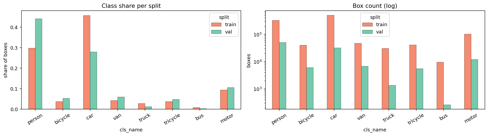
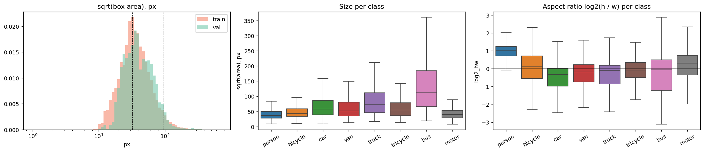
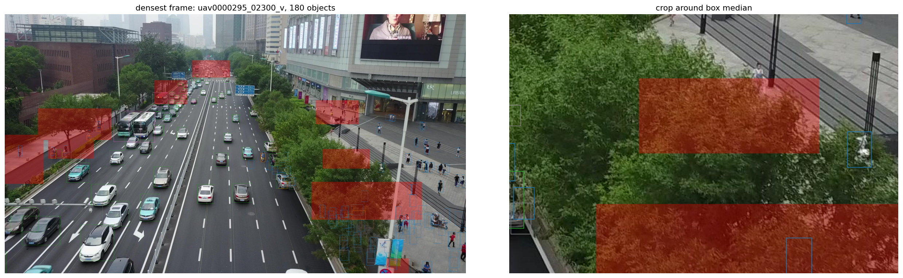
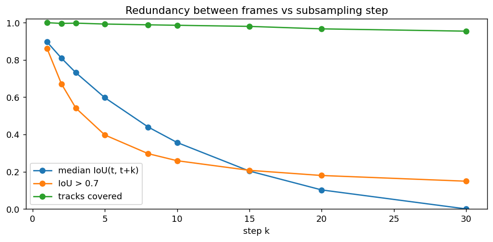
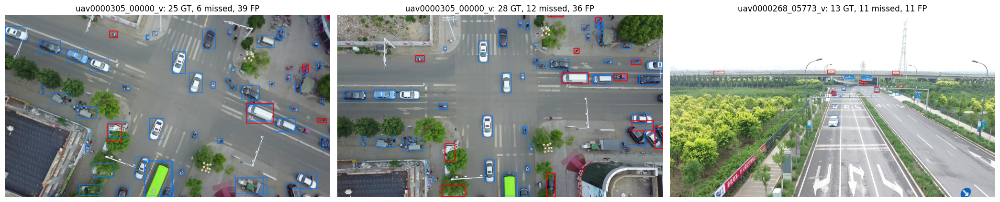
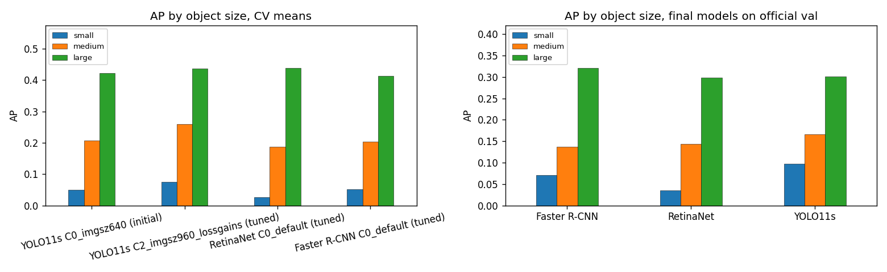
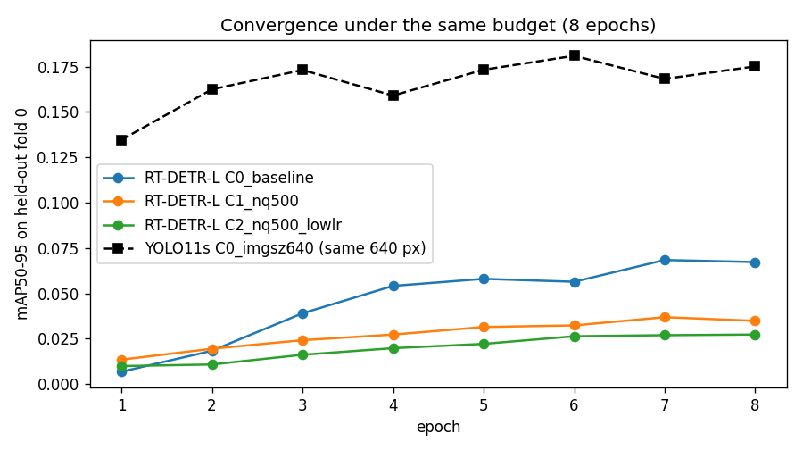
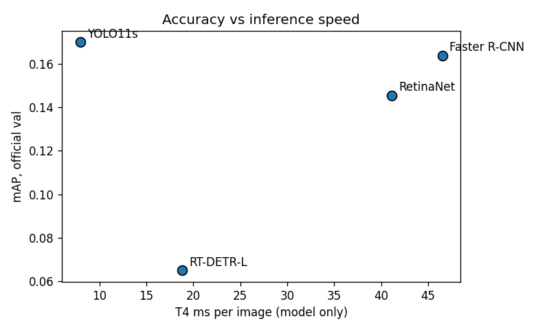
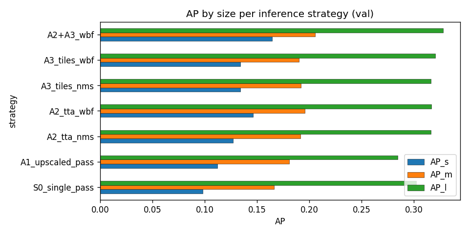
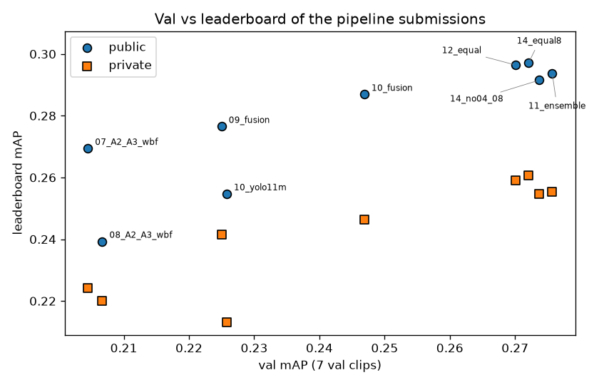

## 1. Task and summary
Detect 8 object classes in drone videoframes (VisDrone2019-VID). Metric: COCO mAP@[0.5:0.95], at most 500 boxes per image.

- Final result: an equal weight fusion of 8 YOLO11 models, each with six-pass test-time augmentation.

**Leaderboard: 0.2972 public / 0.2606 private.**

## 2. Data and preprocessing (notebook 01)

Data observations and consequent decisions:

| Observation | Decision |
|---|---|
| Class imbalance: car 46%, person 30%, bus 0.9%. Val has a different mix (person 44%). | Per-class AP of bus / truck will be noisy. No re-sampling. |
| Tiny objects: median 46 px at full resolution. After resizing to 960 px, 74% are COCO-small. | Higher input resolution and small anchors are used. |
| Up to 180 objects per frame (median 43). | Detectors need more than 200 boxes per image (while torchvision default is 100). |
| Ignored regions in 75% of frames, 18% of the area (on average). | Grayed out in training images, boxes more than 50% inside them are dropped, regions count as `iscrowd` in evaluation. |
| Neighbouring frames ar almost identical (same object IoU 0.90 at t+1). | Keep every 5th frame: 4868 frames, so 99.3% of object tracks are kept. |

Frames were resized to a long side 1280px for export. 

Augmentation is (training time): hor. flip, scale + translate, brightness + color (albumentations for torchvision models, built-in mosaic etc. for Ultralytics)

## 3. Validation design

 **Split by clip, not by frame.** 5 GroupKFold folds over the 56 training clips, grouped by flight, so clips of one flight never appear in both train and validation.
 **Same protocol for all detectors:** train on folds, score held-out clips with one COCO evaluator (pycocotools, `maxDets` 500, ignored regions as `iscrowd`). Folds 0-1 were used (fold 0 only for RT-DETR, bc of budget).
 **Final check:** the best config is retrained on all training frames and scored once on the official val (7 clips, every 5th frame, original resolution).

 Every pipeline step after that is compared on this same val set, and then on the leaderboard scores (after all were submitted).

## 4. Detector families (required comparisons)

Configs change one thing at a time. Here "Tuned" means best mean CV mAP.

| Model (notebook) | Tried | Best CV mAP | Val mAP | AP_small (val) | ms / img | LB public / private |
|---|---|---|---|---|---|---|
| Faster R-CNN R50-FPN (02) | default, data anchors + more proposals, + GIoU | 0.149 (default) | 0.164 | 0.071 | 47 | 0.196 / 0.157 |
| RetinaNet R50-FPN (03) | default, data anchors + lower IoU thresholds, + GIoU | 0.132 (default) | 0.145 | 0.035 | 41 | 0.173 / 0.128 |
| YOLO11s (04) | 640 px, 960 px, 960 px + higher box/dfl loss | 0.188 (960 + loss) | 0.170 | 0.098 | 8 | 0.243 / 0.197 |
| RT-DETR-L (05) | 300 queries, 500 queries, 500 + lower LR | 0.070 (300 q) | 0.065 | 0.027 | 19 | 0.061 / 0.059 |

**Faster R-CNN.** 

Smaller anchors (10-98px) raised AP_small (0.052 to 0.063) but bad on large objects, so mAP dropped. GIoU did not help.

- Two stages. The region proposal network (RPN) finds candidate boxes, and the second stage classifies and refines them.
- The RPN limits recall: the top 1000 proposals cover only 74.5% of objects. More proposals did not help.

Failure cases:
1. Tiny motorbikes and pedestrians are missed.
2. Similar vehicle classes are confused (van/car).
3. Objects partly under trees (occlusions :) ) or cut by the frame edge are missed.
4. In oblique views, distant vehicles are only few pixels tall and so are lost.

**RetinaNet.** 
There is no proposal stage, so about 100k anchors are classified directly. Focal loss handles this imbalance.

- Data-driven anchors with lower IoU thresholds died out (collapsed) in 3 epochs (CV 0.039). Likely bc they no longer match the pretrained head.
- Against the tuned Faster R-CNN it is weaker mainly on small objects (AP_small 0.035/0.071). Its feature pyramid starts at stride 8 instead of 4.

**YOLO11s (anchor-free).** 

Each grid location predicts a box directly. A task-aligned assigner picks the top-k locations inside each object as positives (ranked by score x IoU).

- A 10-15px object covers only 1-2 cells, so resolution matters most (640 to 960px gave +0.032 mAP and +48% AP_small, the loss weights added only +0.002)
- Compared with the anchor-based detectors, the gain is in small and medium objects. It is also about 6 times faster.

**RT-DETR (query-based).** 

Bipartite matching gives each object exactly one query, so no NMS is needed. But each object then trains only one prediction per step, so learning starts slowly.

- With the same budget (8 epochs, 640px), YOLO levels off at approx. 0.17 after 3 epochs. RT-DETR is still rising at 0.068 (it has not converged!!).
- 500 queries were worse, the rebuilt decoder loses its pretrained weights.
- 300 queries already exceed the 180-object maximum, so density was not the limit.

**The Choice is** YOLO. It is the most accurate, the best on small objects and the fastest, which left GPU time for test-time augmentation and larger models testing.

## 5. Final pipeline

### Inference strategy, model fixed (07)

Same YOLO11s model, six prediction passes (full, flip, 1.33x upscale, upscale + flip, overlapping 1.5x tiles, tiles + flip). The passes are merged with Weighted Boxes Fusion (WBF), which averages overlapping boxes instead of keeping one.

| Strategy | Val mAP | AP_small | ms / frame |
|---|---|---|---|
| single pass | 0.170 | 0.098 | 36 |
| flips + upscale, WBF | 0.195 | 0.146 | 192 |
| all six passes, WBF | **0.205** | **0.164** | 357 |

WBF beat NMS for the same passes (0.195/0.191). Leaderboard 0.243 to **0.269** public, 0.197 to **0.224** private.

### Model changes, inference fixed (08, 10, 11, 13)

All rows use the same six passes, on val.

| Model | Val mAP | LB public / private |
|---|---|---|
| YOLO11s 960 px, 8 epochs (04) | 0.205 | 0.269 / 0.224 |
| YOLO11s 1280 px, 20 epochs (08) | 0.207 | 0.239 / 0.220 |
| YOLO11m 960 px, 12 epochs (10) | 0.226 | 0.255 / 0.213 |
| YOLO11l 960 px (11) | 0.253 | – |
| YOLO11m 1280 px (11) | 0.247 | – |
| YOLO11l 1088 px (13) | 0.239 | – |
| YOLO11l 960 px, other seed (13) | 0.230 | – |

Bigger models are better on val, but single-model differences didn't help: 08 and YOLO11m alone scored below YOLO11s on the leaderboard. Two seeds of the same model differ by 0.023 on val, so differences of this size should mostly be noise.

### Fusion of models (09-14)

**Fusion rule is** one WBF across the models' merged outputs.
- A fused box takes at most one box per model.
- Its score is the mean score of the models that found it x the share of models that found it.
- Up to 500 boxes are kept per image.

| Submission | Models | Weights | Val | LB public / private |
|---|---|---|---|---|
| 09 | 2 (YOLO11s x2) | searched | 0.225 | 0.277 / 0.242 |
| 10 | 3 (+ YOLO11m) | searched | 0.247 | 0.287 / 0.246 |
| 11 | 6 (+ YOLO11l, YOLO11m 1280, YOLO11m seed 1) | searched | 0.276 | 0.294 / 0.255 |
| 12 | same 6 | equal | 0.270 | 0.296 / 0.259 |
| **14** | **8 (+ 2 more YOLO11l)** | **equal** | 0.272 | **0.297 / 0.261** |
| 14b | 8 -the 2 weakest | equal | 0.274 | 0.292 / 0.255 |

**Every added group of models raised the private score.** 

Choices made on the 7 val clips did not help:
- searched weights (11) lost to equal weights (12), although they were +0.006 higher on val (probably due to overfitting or smth)
- dropping the two weakest members (14b) lost 0.006, although val was higher.

So the final model uses equal weights and all members.

## 6. What did not work

- Data-driven anchors (RetinaNet, Faster R-CNN).
Smaller anchors taken from the object sizes lowered CV mAP by 0.09 for RetinaNet and by 0.008 for Faster R-CNN. The pretrained heads no longer fit the new anchors, and large objects were lost.

- GIoU box loss (both torchvision models).
No gain. Box regression was not the likely bottleneck within 3 epochs.

- RT-DETR with 500 queries or a lower learning rate.
Fold-0 mAP fell from 0.070 to 0.040 and 0.032. The extra queries need new untrained decoder weights and the model was already undertrained.

- Longer YOLO training, 20 epochs (notebook 08). 
0.014 lower on fold 0 and 0.030 lower on the public leaderboard. The model overfits the training clips.

- Stronger scale augmentation (YOLO11m).
Val mAP 0.219 vs 0.226 with the default setting.

- Temporal rescoring with neighbouring frames.
No effect (+-0.001, tested on 2 val clips). Consecutive frames give nearly identical detections, so they add no new useful information.

- Choosing the 500 boxes per image class by class.
No effect (+-0.001). The 500-box cap only removes very lowscored boxes.

- Tuning fusion weights or members on val.
Higher on val but lower on the leaderboard. With only 7 val clips, the tuning overfits noise.

## 7. Conclusions

1. On tiny, dense objects, resolution and model size matter the most. YOLO (anchor-free) beats the anchor-based and query-based detectors and is the fastest.
2. Test-time augmentation with WBF revealed to be a cheap and reliable gain (+0.035 val, +0.027 private).
3. Fusing many models gave the largest total gain (private 0.224 to 0.261). So large ensambles and fusions probably really do win kaggle competitions
4. With only 7 val clips, its better not to fine-tune on val. Equal weights generalised better than searched ones.

## 8. Final model and how to run

**Selected submission is** `submission_14_equal8.csv` (notebook 14). It fuses 8 models with equal weights, each predicted with the six passes:
YOLO11s 960 (04), YOLO11s 1280 (08), YOLO11m 960 (10), YOLO11l 960, YOLO11m 1280, YOLO11m 960 seed 1 (11), YOLO11l 960 seed 1, YOLO11l 1088 (13).

**Environment.** Kaggle notebooks, Python 3.13 image with pytorch, torchvision, pycocotools and albumentations preinstalled, plus `pip install ultralytics` (8.4). GPU: Tesla T4 x2. Internet on for the pip install and pretrained weights.

**Seeds.** `SEED = 0` for Python, numpy, pytorch and Ultralytics (`seed=1` for the two other-seed models).

**Order to run** (each notebook lists the outputs it needs at the top and stops at once if one is missing):

| Step | Notebook | Hardware | Produces |
|---|---|---|---|
| 1 | `01_data_understanding` | CPU | `vd_prep` (exported frames, folds, config) |
| 2 | `04_yolo11` | T4 | `final_04.pt` |
| 3 | `07_pipeline_inference` | T4 | six-pass submission of 04 |
| 4 | `08_pipeline_training` | T4 | `final_08.pt`, its passes |
| 5 | `09_model_fusion` | CPU / T4 | 04's val passes, 2-model fusion |
| 6 | `10_yolo11m_fusion` | T4| `final_10.pt`, its passes |
| 7 | `11_multi_model_ensemble` | T4  | 3 more models + passes |
| 8 | `12_fusion_cpu` | CPU | equal-weight 6-model fusion |
| 9 | `13_more_large_models` | T4 | 2 more YOLO11l + passes |
| 10 | `14_fusion8_cpu` | CPU | **`submission_14_equal8.csv`** |

Notebooks 02, 03, 05 (the other detector families) and `comparisons` (all tables and figures above) are not needed for the final submission but were useful during this homework and are the required parts.

**Remark:** The tables with results of evaluation in this report were asked to be generated by generative ai based on summary tables from notebooks and then were slightly edited. the orders to run table was also generated. aside from that thats all folks.
